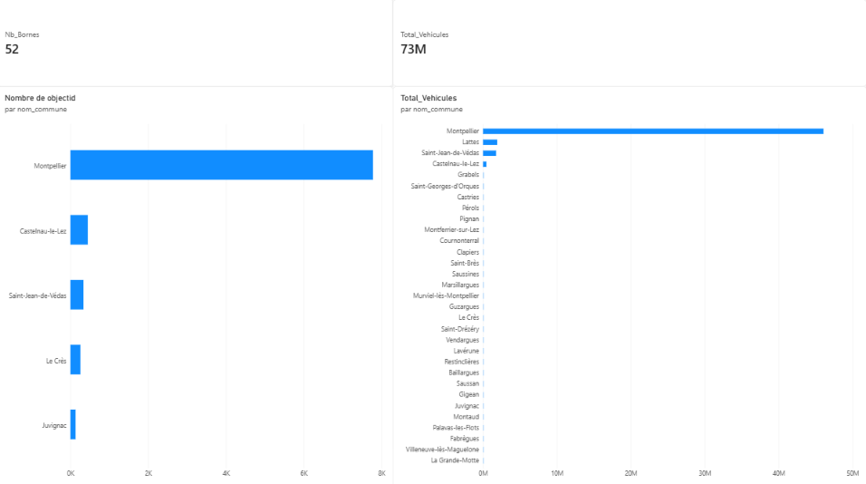

# Analyse des bornes de recharge et du trafic routier à Montpellier

Ce projet étudie le lien entre la circulation automobile et la présence des bornes de recharge pour véhicules électriques dans la Métropole de Montpellier.

## 1. Objectifs
* Comparer la répartition des bornes de recharge avec la fréquentation des axes routiers.
* Construire un tableau de bord Power BI permettant de croiser les données de trafic et d'équipement par commune.

## 2. Données utilisées
Les données proviennent du portail Open Data de la Métropole de Montpellier :
* **MMM_MMM_BornesElecEtotem** : Liste des points de recharge pour véhicules électriques (réseau e-Totem) et de leurs connecteurs.
* **MMM_MMM_Comptage** : Relevés de comptage du trafic routier global.

## 3. Traitement des données et modélisation
* **Power Query** : Harmonisation des noms des communes (`nom_commune`) dans les deux tables pour permettre la jointure.
* **Modèle relationnel** : Création d'une relation plusieurs-à-plusieurs (`*:*`) basée sur la commune.
* **Précision sur la mesure** : Le total des points dans la table des bornes correspond au nombre d'enregistrements techniques (connecteurs et prises individuelles) et non à un nombre d'utilisations.

## 4. Résultats
* **Prédominance de Montpellier** : La ville-centre regroupe la majorité du trafic routier et près de 7 800 points de connexion recensés.
* **Proportionnalité** : Les infrastructures de recharge ont été installées en priorité là où le trafic automobile est le plus dense, montrant une bonne cohérence entre les besoins et les équipements.

